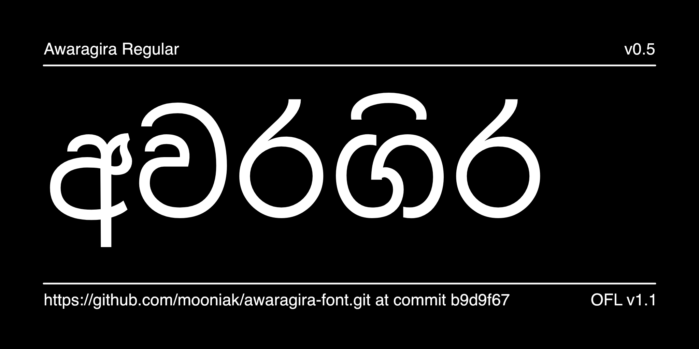
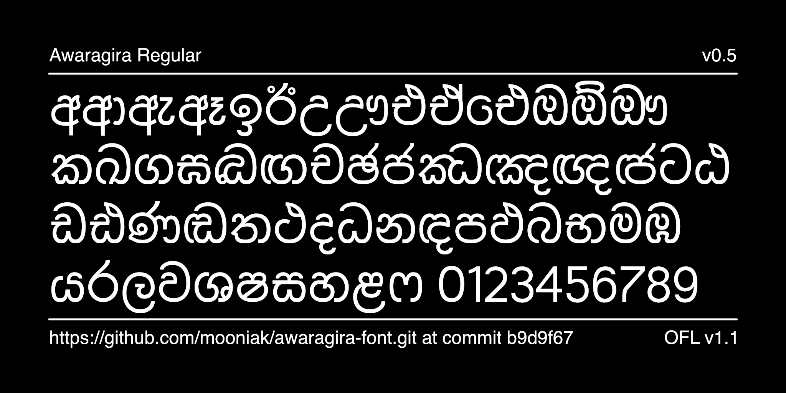

# A default Sinhala font for GNU/Linux systems 

[![Build][badge-build]][link-build]
[![Fontspector QA][badge-qa]][link-qa]
[![Release][badge-release]][link-release]
[](OFL.txt)

[badge-build]: https://github.com/mooniak/awaragira-font/actions/workflows/build.yaml/badge.svg?branch=dev
[badge-qa]: https://img.shields.io/badge/dynamic/json?url=https%3A%2F%2Fsrc.mooniak.com%2Fawaragira-font%2Fbuild.json&query=%24.qa.pass_rate&suffix=%25&label=fontspector%20QA%20(dev%20build)&color=informational
[badge-release]: https://img.shields.io/github/v/release/mooniak/awaragira-font?label=release
[link-build]: https://github.com/mooniak/awaragira-font/actions/workflows/build.yaml
[link-qa]: https://src.mooniak.com/awaragira-font/reports/fontspector/fontspector-report.html
[link-release]: https://github.com/mooniak/awaragira-font/releases




This project is an effort to design and develop a font to become the system default UI typeface on GNU/Linux systems replacing the current LKLUG Font.

< TODO Complete the README >

LKLUG Font has been the system defult for Sinhala text on various GNU/Linux distrtibutuions for a long while. The initial version of the LKLUG Font was meant to just 'work' for Sinhala text 
and was not designed specifically for requierments of a UI typeface. The field of Sinhala typography and type design has seen many advances in academia and 
the industry in the last two decades and we know much more about how to make a font for Sinhala UI text now. While the primary target of the proejct is to release and package the fonts for various Linux distributions, building a sustainable system for maintaining these fonts is another target. 


## About LKLUG Font
The LKLUG or the Lanka Linux User Group which was very active in the early 2000s pioneerd the Sinhala implementation on operating systems. 
< TODO Add History of LKLUG Font >
LKLUG Font copyrights are held by The Wellcome Trust-London, Harshula Jayasuriya, Anuradha Ratnaweera, Harshani Devadithya and first 


## Contributing


## Partners
This project is led by Mooniak.


## Design brief for  new typeface 
<TODO: Translate the note from @aluyama, update the breif >
This repository is for development of a new typeface and a font that can replace LKLUG Font as the system default. 

@aluyama posted the following here: https://github.com/akuru/sinhala-unicode-technical/issues/17

```
වර්තමානයේ ප්‍රසිද්ධ ලිනක්ස් මෙහෙයුම් පද්ධතිවල සිංහල අන්තර්ගත පෙන්වීම සඳහා LKLUG හෝ නොටෝ සාන්ස්/සෙරිෆ් සිංහල බහුලව යොදා ගැනේ. තාක්‍ෂණික ක්‍ෂේත්‍රය ඉලක්ක කර නිමවා තිබෙන අනෙකුත් සිංහල අකුරු සියල්ලටම පාහේ වඩා නොටෝ සිංහල අකුරු ප්‍රමාණයෙන් විශාල වීම ගැටළුවක් හා පාඩුවක් වුවද කියවීමේ අපහසුතාවයක් නැති නිසා මෙහිදී LKLUG පිළිබඳව පමණක් සාකච්ඡාවට බඳුන් කිරීමට කැමැත්තෙමි.

(𑇡). LKLUG මෑත තත්‍වය (පිල්ලම් හඳුනා ගැනීමට නොහැකිය)
(𑇢). LKLUG වත්මන් තත්‍වය* (එපමණක් නොව, අකුරු එකගොඩේ වැටීමද සිදුවේ)
සැ.යු.: වින්ඩෝස් මෙහෙයුම් පද්ධතියට යොදා තිබෙන ඉස්කෝල පොත LKLUG මෝස්තරයට ද වඩා කුඩා නමුදු පිල්ලම් ආදිය හඳුනා ගැනීමට හැකිය. එනම්, මෙය LKLUG නිර්මාණකරුවන්ගේ දුර්වලතාවයකි.

කෙසේ වෙතත්, නොටෝ සිංහල අකුරු මෙහෙයුම් පද්ධති සඳහා දැනටමත් යොදා ගන්නා බැවින් සහ දෝෂ රහිත හෝ අවම යැයි උපකල්පනය කිරීම මත තවමත් LKLUG මෝස්තරය තබාගෙන සිටින සහ මෙතෙක් වෙනත් කිසිදු අකුරු මෝස්තරයකට නොගිය ප්‍රධාන මෙහෙයුම් පද්ධතියකට යෙදීමට යෝජනා කළ විට ඔවුන් එය අර්ධ වශයෙන් යෙදීමට පමණක් කටයුතු කරන ලදි. මන්ද, මෙම අකුරු වර්ගය තිබෙන්නේ වෙනත් අකුරු ගණනාවක් අඩංගු වන fonts-noto-core​ ඇසුරුමෙහිය (පැකේජ්). එබැවින් ඇතැම් මෘදුකාංග විවෘත කිරීමේ දී සියල්ල පූරණය කරගත නොහැකිව බිඳ වැටීමට ලක්වන බව ඔවුන් පෙන්වා දෙයි. කෙසේ වෙතත් ඔවුන් එසේ පැවසුවද නොටෝ අකුරු ඇතුළත් කර පැමිණෙන ලිනක්ස් මෙහෙයුම් පද්ධති ද තිබේ. තවද, නොටෝ සිංහල අකුරු වර්ගය සඳහා තනි ඇසුරුමක් සෑදුවද; fonts-noto-core​ ඇසුරුමෙහි එම අකුරු ගොනුව අඩංගු නිසා අනුමත නොවනු ඇතැයි අදාළ සංවර්ධකයා පවසා ඇත.

පහත සඳහන් දෑ ඉහළින් සපුරන අනර්ඝ අකුරු මෝස්තර පිළිබඳව යෝජනා සහ/හෝ නිර්මාණ දායකත්‍ව අපේක්‍ෂා කෙරේ.

(අ). මෙහෙයුම් පද්ධති, වැඩතල මෘදුකාංග හා ජංගම යෙදුම් සඳහා යොදා ගැනෙන බැවින් එය ඉතාමත් කුඩා හා ඉඩ ඉතා අවමව භාවිතා කරන මෝස්තරයක් විය යුතුය. මන්ද, බොහෝ අවස්ථා වලදී සීමිත අවකාශයක් පිරිමසා ගනිමින් බොත්තම්, පටිති, දැනුම්දීම්, අවවාද, දෝෂ පණිවිඩ ආදියට අදාළ වචන හෝ වාක්‍ය දැක්විය යුතුය. ඇතැම් අකුරු වර්ග පළල ස්වභාවයකින්, දිගැටි හැඩයෙන්, විශාල හෝ මහතකින් යුක්තය. තවද, උස් ස්වභාවයක් ගන්නා අකුරුවල යට කොටස ඇතැම් මෘදුකාංගවල නොපෙනේ.

(ආ). අකුරු ඉතා කුඩා ප්‍රමාණයෙන් ඇතිවිට භාෂාව හදාරන පුද්ගලයෙකුට වුවද පිල්ලම් පහසුවෙන් හඳුනාගත හැකි විය යුතුය. එනම්, උදා. ම, ම්, මි, මී වෙනස හඳුනාගත හැකි විය යුතුය. උදා. මෙවැනි පිටුවක https://si.wikipedia.org/wiki/මුල්_පිටුව
(තවද, ලිනක්ස් LKLUG හා වින්ඩෝස් ඉස්කෝල පොත සංසන්දනය කරන විට; LKLUG අකුරට වඩා කුඩා ඉස්කෝල පොතෙහි හල් කිරීම යොදා ඇති ආකාරය, ඉස්පිල්ල, දීර්ඝ ඉස්පිල්ල ආදිය තීව්‍ර වර්ණයෙන් දිස්වීම නිසා හඳුනාගත හැකිය).

(ඇ). ලිවීමට පමණක් නොවන හෙයින් ඕනෑම තාක්‍ෂණික පරිසරයක දී මෙන්ම විවිධ යෙදවුම් සමඟ හරියාකාරව දිස්වීම සඳහා යාවත්කාලීනව තබා ගැනීමට සහ දෝෂ නිරාකරණයට කණ්ඩායමක් හෝ පුද්ගලයෙක් සිටීම වැදගත්ය. (උදා. දැන් බොහෝ මෘදුකාංග තුළ LKLUG අකුරු එකගොඩේ දිස්වීම සිදුවේ).

(ඈ). සියළුම අකුරු (බැඳි අකුරු ආදානය හා අකුරු බැඳ ලිවීම ද ඇතුළත්ව), සිංහල සංකේත (උදා. කුණ්ඩලිය), සිංහල අංක (ලිත් අංක, පුරාණ අංක) ආදී සියල්ල සඳහා සහාය දැක්විය යුතුය. සැ.යු. එසේ නැතිනම්, අපට අදාළ නිර්මාණකරුවා දැනුවත් කර සකසා ගැනීමට හැකි බැවින් මේ සියල්ල අඩංගු නොවුවද යෝජනා කරන්න.

(ඉ). බොහෝ විට වක්‍රාකාර ස්වරූපය මත පිහිටා අලංකාරය ගෙන දෙන අයුරින් සිංහල අකුරු ලියන බැවින් හොඳ රවුම් මෙන්ම රළු නොවන හුරුබුහුටි සහ මෘදු ස්වභාවයක් පෙන්නුම් කරන ආකර්ෂණීය අකුරු වර්ගයක් සුදුසුය.

```
